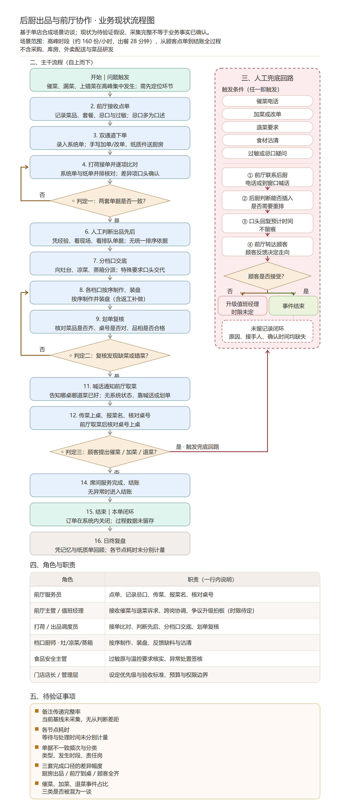
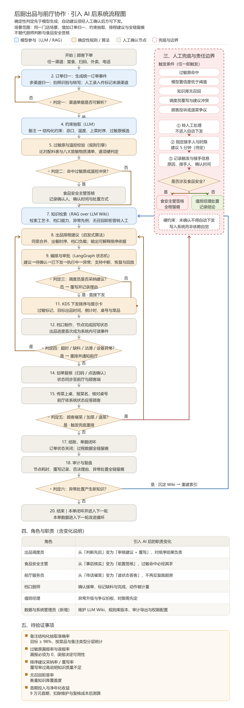

# kitchen-collab · 后厨出品协同系统（原型）

> 把「纸质加单与系统单同时到厨、靠喊沟通、凭经验排序」的后厨，
> 变成「订单归一 → 确定性校验 → 食安签核 → 可解释排菜 → 全程留痕」的协同系统。

**项目定位**：一个可以跑起来的单店试点原型，演示 AI 辅助后厨调度的**价值边界**——
系统只做「建议、校验、留痕」，所有写操作（改顺序、改派、退菜、替代食材）一律走
**建议 → 人工确认 → 审计留痕**，不做静默执行。

## 为什么做这个

来自一份单店需求发现材料的三个事实：

| 现状 | 数字 |
|---|---|
| 高峰出餐时长 | 28 分钟（目标压到 18 分钟） |
| 每晚漏菜 | 14 次（目标降到 3 次以内） |
| 人工催菜查询 | 高峰每小时约 70 次 |
| 过敏备注传递 | 套餐拆单后备注丢失 —— **不可逆风险，优先级高于一切效率优化** |

后厨的瓶颈不在「看不见」，而在「对不上」：纸质单与系统单没有统一排序依据（单据断点）、
套餐拆单后备注与订单失联（关联断点）、厨房/前厅/顾客三套完成定义不可比（口径断点）。

**业务现状**（三个判定断点 + 17 项人工跑腿回访）与**数智化转型后的目标流程**（LLM/RAG/规则引擎分工）见：





## 核心能力

- **多源订单归一**：POS / 堂食扫码 / 外卖 / 电话·纸质补录统一进同一笔业务，撞单只提示、不静默合并
- **结构化解析**：规则解析器离线可用；配置 LLM API 后自动升级，调用失败自动降级回规则
- **确定性校验（BLOCK 级）**：过敏原冲突直接拦截（不是「提示」），未知菜品给相似候选转人工
- **食安签核**：含过敏行的单，食安岗未签核不得排菜
- **可解释排菜**：P0 过敏置顶 / 催菜加权 / 外卖时限 / 工序链关键路径，每条排序都带理由
- **多角色协同**：点品员、食安主管、厨师长、档口厨师、传菜五个角色事件驱动，职责边界清晰
- **口径统一的看板**：出餐时长（接单→上桌）、漏菜、催菜、过敏传递率 100% 硬门槛
- **可重建的审计留痕**：JSONL 逐条记录「谁、何时、对哪笔业务、做了什么、改前改后」

## 30 秒上手

```bash
git clone <repo-url> && cd kitchen-collab
pip install -r requirements.txt      # 只有 PyYAML 一个依赖

# Windows
set PYTHONPATH=src
# macOS / Linux
export PYTHONPATH=src

python -m kitchen_collab.main demo   # 内置晚市高峰演示
```

演示会还原一个真实晚市：POS 单 + 纸质加单撞单、套餐拆单过敏、外卖单、电话单写错菜名、
缺料、催菜——你可以看到每一步是「系统拦截」「食安签核」还是「建议待确认」。

## 运行测试

```bash
python -m unittest discover -s tests -v    # 11 个用例
```

## 接入你自己的订单

```bash
python -m kitchen_collab.main run data/sample_orders.json
```

订单 JSON 格式见 `data/sample_orders.json`，菜品工艺卡在 `config/default.yaml` 里维护
（过敏原库由门店食安负责人维护，系统只做传递与校验，不做判断）。

## 可选：启用 LLM 解析

```bash
export KITCHEN_LLM_API_KEY=sk-xxx          # OpenAI 兼容接口
export KITCHEN_LLM_BASE_URL=https://...    # 可选，默认 OpenAI
export KITCHEN_LLM_MODEL=gpt-4o-mini       # 可选
```

自由文本订单（如电话口述）将走 LLM 结构化；解析置信度低于阈值自动进人工修复队列，
不进自动推荐样本。

## 目录导览

```
docs/design.md    设计思路：三个断点 → 架构决策 → 口径定义（先读这个）
docs/api.md       核心接口说明
docs/roadmap.md   一期 / 二期功能边界（脱敏版）
src/kitchen_collab/core/    全部核心逻辑
tests/            测试（unittest 风格，兼容 pytest）
examples/demo.py  跑得起来的示例
config/           菜品工艺卡、排序权重、验收目标（非机密）
data/             样例订单 + 运行时生成的审计日志（不入库）
```

## MVP 边界

本项目按「最小可行产品」方法划分功能层次——判断标准：**砍掉后价值闭环是否还成立**。

| 层次 | 内容 | 理由 |
|---|---|---|
| **核心闭环（MVP）** | 多源订单归一 → 过敏/未知菜确定性校验 → 可解释排菜看板 | 三步砍掉任何一步，「把靠喊变成有据可查」的价值就不成立 |
| **信任层（半核心）** | 食安签核流、审计留痕、建议→确认→不静默执行 | 餐饮场景的不可逆风险决定了留痕不是可选品 |
| **增强层** | 改派建议、催菜/缺料事件、指标看板 | 让闭环更好用，砍掉不影响验证 |
| **外围层** | LLM 解析、终端美化、HTML 报告页 | 演示与体验性质，全部可替换 |

二期方向见 [docs/roadmap.md](docs/roadmap.md)。

## 设计红线

1. 过敏/食安逻辑必须走**确定性校验**，不允许降级为「提示」
2. 所有写操作走**建议 → 人工确认 → 留痕**，禁止静默执行
3. 备注随套餐拆单**逐行传递**，不允许静默合并过敏信息
4. 指标口径四要素（分子/分母/排除规则/统计周期）改动必须写进 docs/design.md

## License

[MIT](LICENSE)
